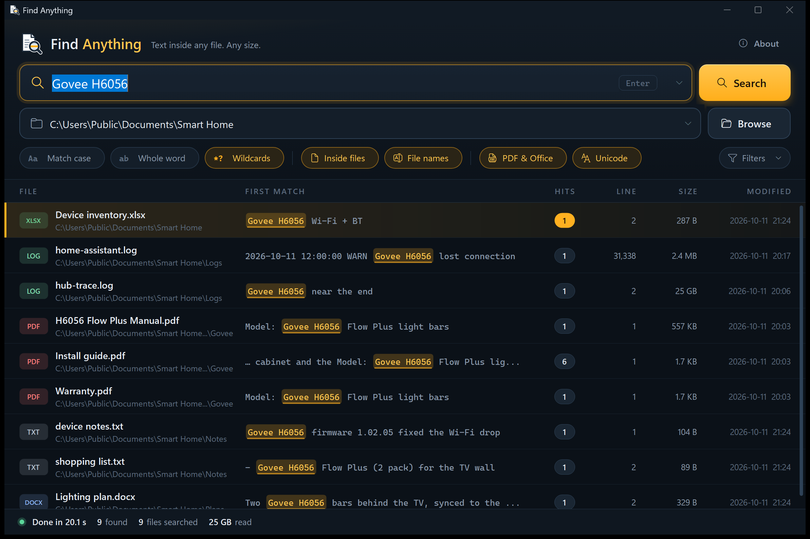
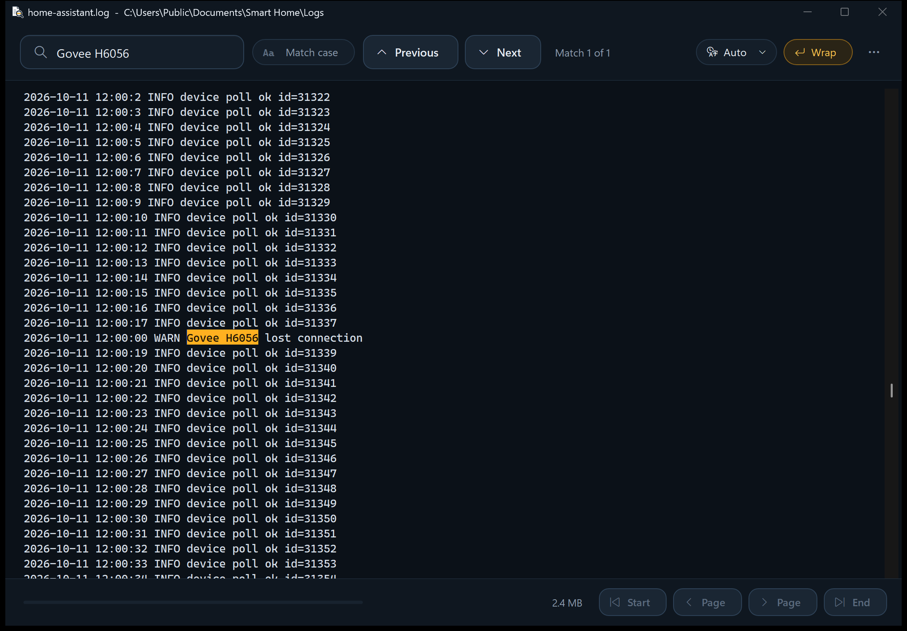
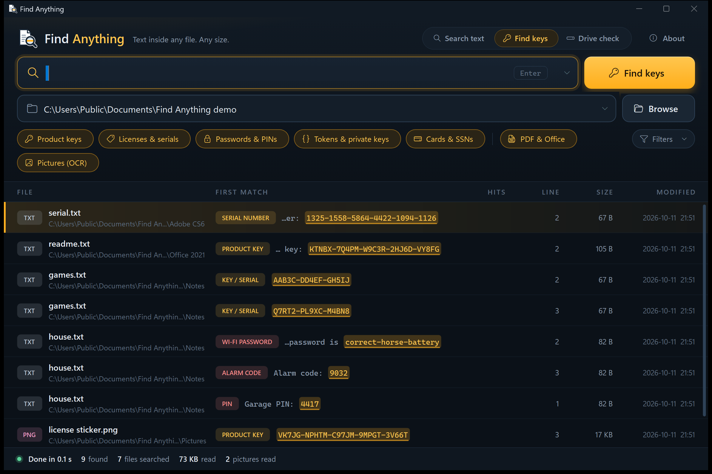
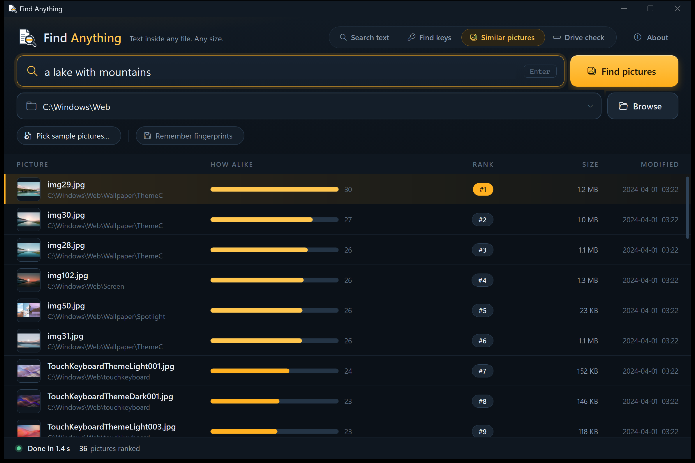
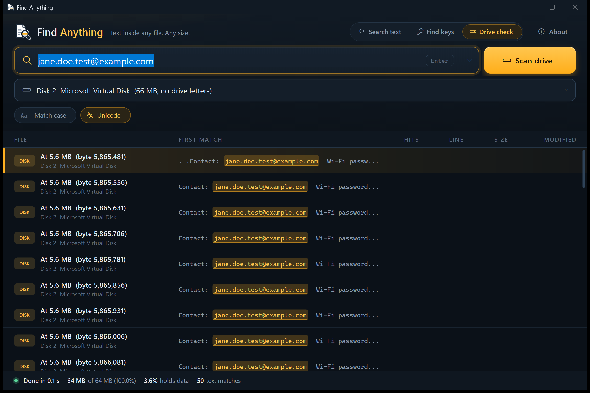
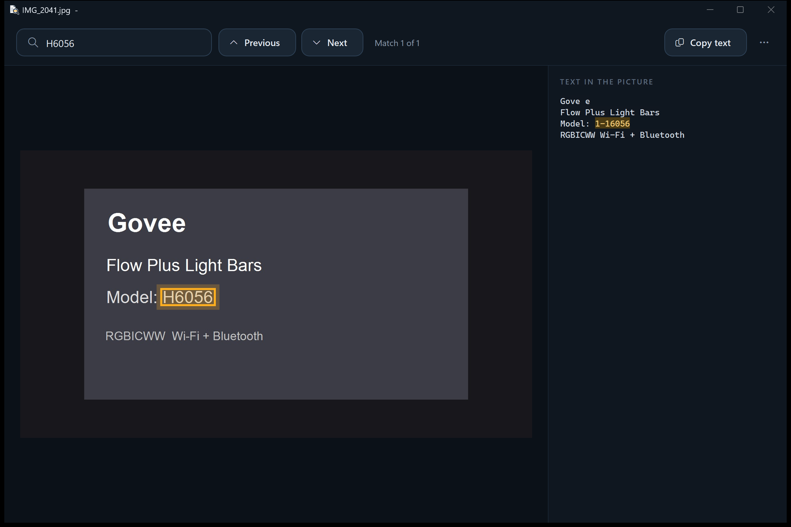

# Find Anything

A Windows app that finds text inside files. Point it at a folder or a whole drive, type `Govee H6056`, and get a
list of every file that contains it. Double-click a file to open it with every match highlighted, even when the
file is 25 GB.

Everything runs on your PC. Nothing goes online, except one optional download you are asked about first: the picture
model for Similar pictures.





## Four modes

**Search text** finds any text inside any file, with the extras below.

**Find keys** finds the product keys, licenses, serial numbers, passwords, PINs and tokens you stashed in a text file
months ago, without you typing anything. It also reads documents and pictures of license stickers. Each key gets its
own row; right-click it and choose **Copy the key**. Type a word to narrow the list to keys near it (Office, Adobe).



**Similar pictures** finds photos that look like the one you have. Press **Pick samples** (the Polaroid of Grandma,
the dog these tests were run on) or drop a sample picture, or several of the same thing, and you get the pictures in the
folder that really look alike, closest first. Pictures that do not look alike are left out (**Show weaker matches**
lists them too). Or describe it instead: `a dog in a costume`, `a receipt`, `the beach at sunset`. Right-click any
picture result, or a picture in Explorer, and choose **Find similar pictures**.



Two models do the work, both 8-bit, through Microsoft's ONNX Runtime on the CPU, so no graphics card is needed. A
sample picture is matched by Meta's **DINOv2** (small), which judges how pictures *look*: the same dog, the same
place. A description is matched by OpenAI's **CLIP** (ViT-B/32), which connects words to pictures. The models are not
in the installer: the first time you use this mode, the app asks, then downloads them once (137 MB, from this
project's releases, checked against a pinned SHA-256) into `%LOCALAPPDATA%\FindAnything\ai`. After that it works
offline and nothing about your pictures leaves your PC.

**CPU use** sets how many pictures are read at once, one CPU thread each, from 1 (cool and quiet) to every thread. It
starts at a quarter of them (2 on an 8-thread laptop), can be changed in the middle of a search, and the work always
runs at below-normal priority so the PC stays responsive. Measured on an i7-12900K (24 threads), 58 pictures:

| CPU use | Pictures a second | Threads busy on average | CPU time per picture |
|---|---|---|---|
| 1 | 10 | 0.8 | 86 ms |
| 6 (default here) | 57 | 4.4 | 78 ms |
| 24 | 100 | 17.9 | 179 ms | **Remember fingerprints** (off by default) keeps each picture's fingerprint in
`%LOCALAPPDATA%\FindAnything\pictures` so repeat searches skip the work; turning it off deletes them.

How well does it work? Measured on 22 photos of one dog and 242 unrelated pictures (photos of people and
rooms, and Windows wallpapers), using every dog photo as the sample in turn:

| | Unrelated pictures ranked above the dog's worst photo | Highest unrelated score | Dog photos, low end |
|---|---|---|---|
| CLIP (the first version) | 9.7 on average | 0.75 | 0.66 |
| DINOv2 (now) | **none** | 0.22 | 0.35 |

So the cut-off sits at 0.25: 99.6% of the same-dog pairs score above 0.30, and no unrelated picture came near it.
A first try with CLIP alone ranked a photo of a child second for a photo of the dog (CLIP saw "a close-up face on a
couch" in both); DINOv2 scores that photo 0.12.

**Drive check** reads a whole drive, every sector and read-only, before you sell or give it away. It tells you how
much of the drive still holds data (a wiped drive is all zeros) and lists every place a text of yours still appears,
including inside deleted files. It needs administrator rights; the app offers to restart with them.



## Text in pictures

Turn on **Pictures (OCR)** and the text in photos, screenshots and scanned PDFs becomes searchable. Add **Only pictures**
to skip everything that is not a picture, which is handy for a whole Pictures folder. Picture results show a thumbnail;
hover over it for a large preview. It uses the OCR
engine built into Windows 10/11, so nothing leaves your PC. Open a picture and the match is boxed on the photo itself.

By default nothing OCR reads is kept: pictures are read again on every search. Turn on **Remember OCR text** to keep it
in `%LOCALAPPDATA%\FindAnything\ocr`. Each picture is then read only once and repeat searches are much faster, but the
text of your pictures is stored on your PC. Turning it off deletes what was stored.



OCR makes mistakes: it can read an H as `1-1` or an m as `rn`. Turn on **Loose** and the search shrugs those off.

**CPU use** (shown while Pictures (OCR) is on) sets how many pictures are read at once. Windows OCR uses one CPU thread
per picture, so it is the CPU budget: on an i7-12900K, 1 at a time reads about 9 text-heavy pictures a second with less
than one thread busy, 8 at a time about 69 a second with 6 threads busy. Plain files are not held back, OCR runs at
below-normal priority, and the setting is shared with Similar pictures and takes effect immediately.

## Install

1. Download **FindAnything-Setup.exe** from the [latest release](https://github.com/ToddJSherman/FindAnything/releases/latest).
2. Run it and click **Install**. It installs for your user only, so it needs no admin rights. You can choose:
   - a Start menu shortcut, with **Ctrl+Alt+F** to open the app from anywhere
   - a desktop shortcut
   - **Find Anything here** on Explorer's right-click menu for folders and drives, and **Find similar pictures** for
     pictures. On Windows 11 they are under *Show more options*.
3. To remove it, use **Settings > Apps > Installed apps > Find Anything > Uninstall**.

The files are not code-signed, so Windows SmartScreen may say it "protected your PC". Click **More info**, then
**Run anyway**. Prefer no installer? Download **FindAnything.exe** from the same release and run it from anywhere.

Requires Windows 10 or 11, which already include the .NET Framework 4.8 it needs.

## What it does

- **Searches inside files**: any file type, including binaries. It also searches **file names** if you tick that box.
- **Wildcards**: `*` matches any run of characters on the same line, and `?` matches one character.
  `Govee*6056` finds "Govee RGBIC H6056". `H60?6` finds H6056 and H6066.
- **Match case** and **whole word** switches.
- **Loose**: ignores spaces, dashes and case, and treats look-alikes as the same (O and 0; I, l and 1; S and 5; and
  OCR's `1-1` for H). Typing `H6056` finds `H-6056`, `h 6056` and `H6O56`.
- **File types**: `*.txt` searches only TXT files, so a DOC that contains the text is not counted. Separate several
  types with `;`. **Except** skips types such as `*.exe;*.iso`.
- **Reads the real text in PDF, DOCX, XLSX, PPTX and OpenDocument files.** Their text is compressed, so a plain byte
  search misses it. The PDF reader is built in and handles compressed and encrypted PDFs (the kind that open without
  a password). Scanned PDFs are pictures of text, so they have nothing to find. They are listed under *notes*.
- **Unicode (UTF-16) text**: Notepad "Unicode" files, old `.doc` files, and strings inside programs.
- **Skip folders** by name (wildcards allowed), skip files over a size, and set how many files are searched at once.
- **OneDrive online-only files are skipped**, so a search never downloads your cloud files.
- **Paths longer than 260 characters** work without changing any Windows setting.

## Big files

Nothing is ever loaded whole.

- The search streams each file through a 4 MB buffer. A 25 GB file costs the same memory as a 4 KB one.
  Measured: a 25 GB file scanned in 18 s with a peak of 20 MB of memory.
- The viewer shows 1 MB of the file at a time (small files show whole). It opens a 25 GB file instantly at the first
  match. **Next / Previous** (F3 / Shift+F3) search the rest of the file in the background with a progress readout,
  and Esc stops them. The slider and the Page buttons move through the file.
- **Open with its usual program** and **Open in Notepad++** warn you first when a file is over 200 MB, and offer the
  built-in viewer instead.

## Using it

| Do this | To |
|---|---|
| Enter in the Find box | Search |
| Esc | Stop the search |
| Double-click or Enter on a result | Open it in the viewer with matches highlighted |
| Right-click a result | Open with its usual program, open in Notepad++ at the line, show in folder, copy path, save the list as CSV |
| Click a column header | Sort by it |
| Drop a folder on the window | Set *Look in* (in Similar pictures, dropped pictures become the samples) |
| `C:\;D:\` in *Look in*, or pick `(all drives)` | Search several places |
| *notes* link in the status bar | See locked files, access-denied folders, password-protected or scanned PDFs |

**Right-click menu.** `tools\explorer-menu.ps1` adds **Find Anything here** to Explorer's right-click menu for
folders, for empty space inside a folder, and for drives, and **Find similar pictures** for picture files. It is per-user, so no admin is needed. On Windows 11 it is
under **Show more options** (or Shift+F10). `-Uninstall` removes it.

```
powershell -ExecutionPolicy Bypass -File tools\explorer-menu.ps1
```

Command line: `FindAnything.exe "D:\Some folder"` starts with *Look in* set.
`FindAnything.exe --view <file> --find <text>` opens only the viewer.
`FindAnything.exe --similar <picture>` searches the picture's folder for pictures like it.

Settings live in `%APPDATA%\FindAnything\settings.txt`, one plain-text `key=value` per line: only toggles and filters.
What you type (searches, folders) is never saved.

## Build

```
build.cmd          builds bin\FindAnything.exe and the installer bin\FindAnything-Setup.exe
build.cmd test     also builds and runs the tests
```

It uses the C# compiler that ships with Windows (.NET Framework 4.8), so there is nothing to install. The tests
generate extra PDFs with Python (PyMuPDF and reportlab) when those are available. Those PDFs are written by other
libraries, which checks the PDF reader against files it did not write itself. Without Python those tests are
skipped.

## Layout

```
src/Core/   search engine: BytePattern (wildcard matcher), Scanner (streaming), SearchJob (folders, threads),
            DocText (Office/ODF), PdfDoc + PdfText + PdfLexer (PDF reader), LongPath,
            Secrets (key/serial/password detectors), Ocr (Windows OCR + cache), RawDisk (drive check),
            Ort (ONNX Runtime C API by P/Invoke), Clip (DINOv2 + CLIP fingerprints, CLIP tokenizer), PictureSearch
src/App/    window, results list, viewer, About box; Skin.cs (theme, 9-sliced sprites, custom controls); skin/*.png
src/Setup/  installer and uninstaller (one exe; the app and LICENSE are embedded in it)
src/AppInfo.cs  version, credits and file details shared by both exes
tools/      explorer-menu.ps1 (right-click menu for a copy run without the installer)
tests/      Tests.cs (131 checks), make_pdfs.py (test PDFs from PyMuPDF and reportlab)
design/     icon concepts, the app icon source (SVG), and the UI design (ui/main.html mockup, ui/sprites.html skin)
docs/       README screenshots
```

## Limits

- Case-insensitive matching folds A-Z only. In UTF-8 files, `é` and `É` are different.
- `?` matches one byte in UTF-8 text, so it stands for one ASCII character but only part of an accented one.
- Text inside ZIP, 7z or ISO archives and inside email stores is not searched, apart from the Office formats above.
- PDFs larger than 512 MB are searched as raw bytes instead of being parsed.
- OCR needs a Windows language with text recognition (English has it). OCR reads up to 40 pages of a scanned PDF.
- Find keys works by patterns, so it can miss a key written in an unusual way and list a code that only looks like a key.
- A crypto-erased drive can read as random data, so Drive check reports it as holding data even though it is wiped.
- Similar pictures matches by look, not identity: a dog of the same breed and colouring can count as alike. Several
  sample pictures help (a picture only has to look like one of them). Descriptions work best in plain English, and
  their cut-off is relative (the top band of scores), because CLIP's text scores are not comparable between sentences.

## Credits

Created by **Todd J Sherman** ([@ToddJSherman](https://github.com/ToddJSherman)).

The search engine, PDF reader, viewer and installer are written from scratch in C#, with no third-party libraries.
The optional Similar pictures download contains third-party files, unchanged and under their own licenses (the license
texts are in the download): Microsoft [ONNX Runtime](https://github.com/microsoft/onnxruntime) 1.20.1 (MIT), Meta
[DINOv2](https://github.com/facebookresearch/dinov2)-small (Apache 2.0) and OpenAI [CLIP](https://github.com/openai/CLIP)
ViT-B/32 (MIT), both in the 8-bit ONNX exports by [Xenova](https://huggingface.co/Xenova). The app calls ONNX Runtime's C API directly and turns
its usage events off.
The look was designed in HTML/CSS (`design/ui/main.html`). Small animations (hover fades, the sliding mode tab, results
and thumbnails fading in) run on one shared timer and switch off when Windows' *Animation effects* setting is off. `tools/make-skin.ps1` renders its controls and cuts them into
the PNG sprites the app draws, so the app matches the design.

## License

[MIT](LICENSE). Copyright (c) 2026 Todd J Sherman. Use it, change it and share it. Keep the copyright notice.
